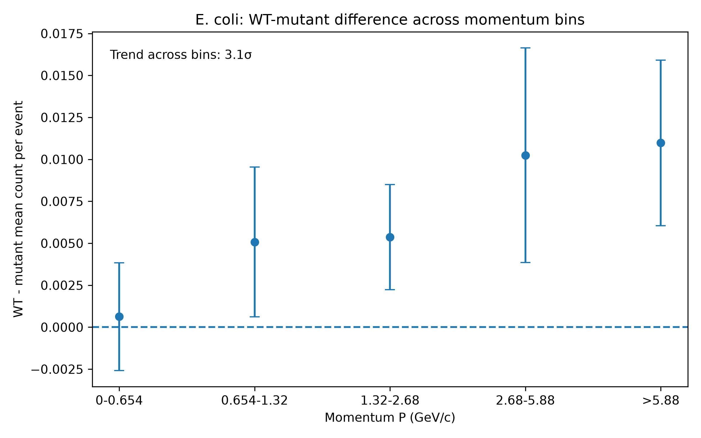
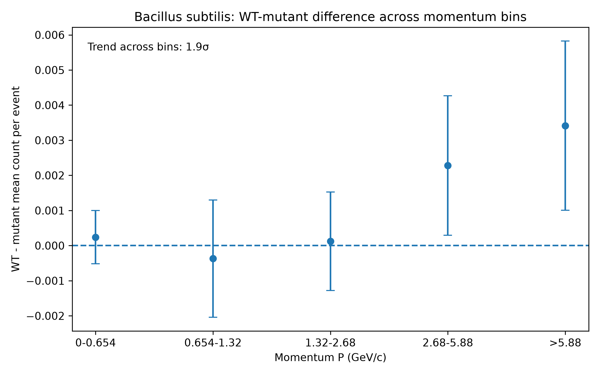
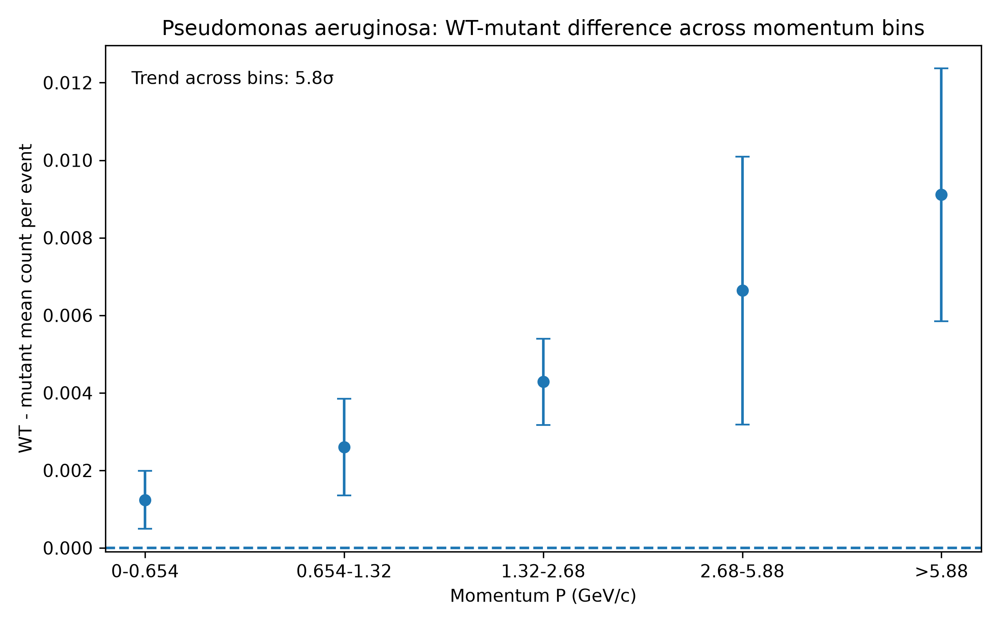
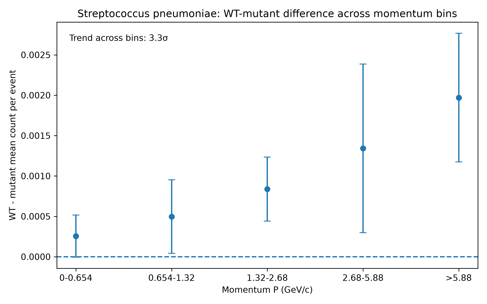
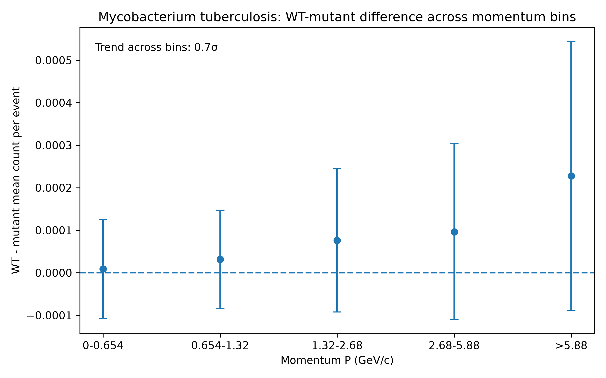
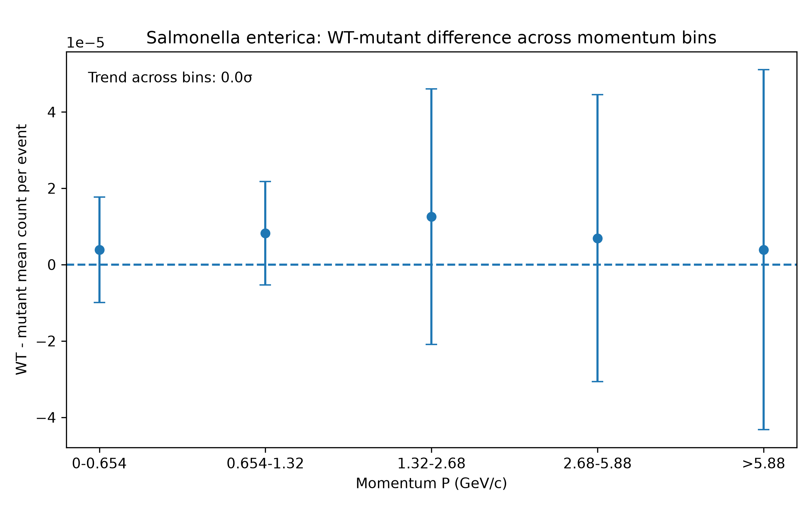

Anna Černá (i6423723)
# Biology-themed exercise in R programming language

## Project overview
In this project, we analyse simulated bacterial tracking data from 10 independent data sets, each containing 500 000 events (5 million events in total). Each event represents one simulation run and it contains the number of bacteria which were observed in that run. For each bacterium, the data contain three momentum components (px, py, pz) and an ID that identifies the strain of bacteria. 

In our analysis, we focus on 12 bacterial strains. They are organised into 6 pairs for comparison (normal vs mutant / normal vs antibiotic-resistant strains). 

## Questions:
The analysis aims to answer the following questions: 

1. What is the average number of bacteria per (non-empty) event for each of the 12 bacterial strains? And what is the statistical uncertainty of each average?
2. For each of the six strain pairs, is the difference between the two average counts statistically significant, and what is the significance in units of σ?
3. Does the WT–mutant asymmetry change significantly across momentum bins ?

## Bacterial strains analysed:
| ID | Bacterial strain |
|---:|---|
| 211 | E. coli WT |
| -211 | E. coli mutant |
| 321 | Bacillus subtilis WT |
| -321 | Bacillus subtilis mutant |
| 2212 | Pseudomonas aeruginosa WT |
| -2212 | Pseudomonas aeruginosa antibiotic-resistant |
| 3122 | Streptococcus pneumoniae |
| -3122 | Capsule-deficient Streptococcus pneumoniae |
| 3312 | Mycobacterium tuberculosis |
| -3312 | Drug-resistant Mycobacterium tuberculosis |
| 3334 | Salmonella enterica |
| -3334 | Salmonella mutant |

## Data analysis 
1. Question 1: Number of bacteria per event
Each of the 10 data sets is analysed separately:

- The R code reads the input file line by line. Event headers are identified and used to determine how many bacterial rows belong to each event. The program then loops through the bacteria in each event and selects only the bacterial IDs relevant to this analysis.

- For every bacterial strain, the total number of bacteria is counted across the data set.

- Events containing zero bacteria are excluded when calculating the number of bacteria per event.

- The average number of bacteria is calculated as: total bacterial count / number of nonempty events.

After the 10 individual data sets are separately analysed, their results are combined using the sub-sampling method. For each bacterial strain, the final mean is calculated from the 10 sub-sample results. Because the number of non-empty events may differ slightly between the data sets, the sub-sample means are combined using a weighted average. The statistical uncertainty is calculated as the standard deviation of the 10 sub-sample means.

2. Question 2: Asymmetry between strain pairs
for each of the six bacterial strain pairs:

the WT–mutant difference is calculated separately in each of the 10 data sets:
- difference = mean WT count per event - mean mutant count per event

This gives 10 differences for each strain pair. The final asymmetry is then calculated as the mean of these 10 differences, and the statistical uncertainty is taken as their standard deviation. The significance is calculated as:
- significance = |mean difference| / statistical uncertainty

A result above 3σ is considered statistically significant asymmetry.

2. Question 3: Momentum-dependent assymetry
For each bacterium, the momentum magnitude is calculated from its three momentum components:
P = sqrt(px^2 + py^2 + pz^2)

The bacteria are divided into five momentum bins:
- 0–0.654 GeV/c
- 0.654–1.32 GeV/c
- 1.32–2.68 GeV/c
- 2.68–5.88 GeV/c
- 5.88 GeV/c

For each data set and each momentum bin, the mean WT count per event and mean mutant count per event are calculated and subtracted. This gives 10 WT–mutant differences for every strain pair and momentum bin. The mean of these 10 differences is plotted, with the standard deviation used as the statistical uncertainty.

To test whether the asymmetry changes systematically across momentum bins, a linear trend is fitted separately to the five bins in each of the 10 data sets. This gives 10 slopes for each strain pair. The mean slope is used as the trend estimate, the standard deviation of the slopes as its uncertainty, and the trend significance is calculated as |mean slope| / SD.

Because the momentum bins have unequal widths and the highest bin is open-ended, this is interpreted as a trend across ordered momentum bins, not as a physical slope per GeV/c.

## How should the analysis be run?
The analysis is performed in Python and R.
In python the following libraries are used:
- numpy
- matplotlip
- pandas 

They can be installed using: pip install pandas numpy matplotlib

Three scripts are used for the analysis: 

1. neconeco.R is run separately on each of the 10 raw data files. It calculates the overall bacterial counts and the WT–mutant differences in each of the five momentum bins.

2. neconeco.R combines the 10 overall result files (it will ask for the user to input them) It calculates the final average count and uncertainty for each strain, and the overall WT–mutant asymmetry using the difference-first subsampling method.

3. Project_visualisation.py combines the 10 momentum result files (the user should have them in the working directory). In each momentum bin, it calculates the mean WT–mutant difference and uncertainty. Then it tests the trend across momentum bins, and creates the final figures.

## Results
### Average bacterial counts per event
| ID | Mean bacteria per non-empty event | Statistical uncertainty |
|---:|---:|---:|
| 211 | 19.9495 | 0.0327 |
| -211 | 19.9172 | 0.0319 |
| 321 | 2.50915 | 0.00477 |
| -321 | 2.50346 | 0.00550 |
| 2212 | 1.20803 | 0.00190 |
| -2212 | 1.18416 | 0.00241 |
| 3122 | 0.276599 | 0.001074 |
| -3122 | 0.271696 | 0.000985 |
| 3312 | 0.039441 | 0.000284 |
| -3312 | 0.039000 | 0.000402 |
| 3334 | 0.001187 | 0.000042 |
| -3334 | 0.001152 | 0.000051 |

### Comparison between strain pairs
| Strain pair | Mean WT−mutant difference | Statistical uncertainty | Significance | Interpretation |
|---|---:|---:|---:|---|
| *E. coli* (211 vs −211) | 0.032297 | 0.004519 | **7.15σ** | Significant asymmetry |
| *B. subtilis* (321 vs −321) | 0.005691 | 0.003294 | 1.73σ | No significant asymmetry |
| *P. aeruginosa* (2212 vs −2212) | 0.023873 | 0.002373 | **10.06σ** | Significant asymmetry |
| *S. pneumoniae* (3122 vs −3122) | 0.004903 | 0.000583 | **8.41σ** | Significant asymmetry |
| *M. tuberculosis* (3312 vs −3312) | 0.000441 | 0.000488 | 0.90σ | No significant asymmetry |
| *S. enterica* (3334 vs −3334) | 0.000036 | 0.000069 | 0.52σ | No significant asymmetry |

The strongest overall asymmetry was observed for P. aeruginosa (10.06σ), followed by S. pneumoniae (8.41σ) and E. coli (7.15σ). The remaining three strain pairs were below the 3σ significance threshold. That's why we can conlude that they are statistically compatible within the uncertainties. 

### Asymmetry within momentum bins 
| Strain pair | Significant bins | Largest bin significance | Momentum range of largest significance | Difference in that bin |
|---|---:|---:|---|---:|
| *E. coli* | 0 / 5 | 2.23σ | >5.88 GeV/c | 0.010983 ± 0.004932 |
| *B. subtilis* | 0 / 5 | 1.42σ | >5.88 GeV/c | 0.003414 ± 0.002410 |
| *P. aeruginosa* | **1 / 5** | **3.85σ** | 1.32–2.68 GeV/c | 0.004284 ± 0.001112 |
| *S. pneumoniae* | 0 / 5 | 2.47σ | >5.88 GeV/c | 0.001970 ± 0.000797 |
| *M. tuberculosis* | 0 / 5 | 0.72σ | >5.88 GeV/c | 0.000228 ± 0.000316 |
| *S. enterica* | 0 / 5 | 0.61σ | 0.654–1.32 GeV/c | 0.00000823 ± 0.00001357 |

Only one individual momentum bin exceeded the 3σ threshold: the 1.32–2.68 GeV/c bin for P. aeruginosa.

However, just because the result was  >3σ result in an individual bin does not contradict a significant overall asymmetry. Splitting the data into five momentum bins reduces the amount of data contributing to each estimate, which increases the relative statistical uncertainty.

### Trend across momentum bins
| Strain pair | Mean trend across bins | Trend uncertainty | Trend significance | Interpretation |
|---|---:|---:|---:|---|
| *E. coli* | 0.002588 | 0.000831 | **3.11σ** | Significant momentum trend |
| *B. subtilis* | 0.000900 | 0.000464 | 1.94σ | No significant momentum trend |
| *P. aeruginosa* | 0.001978 | 0.000341 | **5.80σ** | Significant momentum trend |
| *S. pneumoniae* | 0.000428 | 0.000129 | **3.33σ** | Significant momentum trend |
| *M. tuberculosis* | 0.000050 | 0.000073 | 0.69σ | No significant momentum trend |
| *S. enterica* | approximately 0 | 0.000007 | 0.02σ | No significant momentum trend |

Significant trends across momentum bins were observed for E. coli, P. aeruginosa, and S. pneumoniae. No significant momentum dependence was observed for B. subtilis, M. tuberculosis, or S. enterica.

### Figures for the asymmetry dependence on momentum

#### 1. *E. coli*

*Figure 1. E. coli WT-mutant difference across momentum bins. Each point shows the mean WT-mutant difference across the 10 subsamples, with the standard deviation shown as the error bar. The dashed line represents no asymmetry. The trend across momentum bins is significant (3.11σ), indicating momentum dependence.*

#### 2. *Bacillus subtilis*

*Figure 2. Bacillus subtilis WT-mutant difference across momentum bins. Each point shows the mean WT-mutant difference across the 10 subsamples, with the standard deviation shown as the error bar. The dashed line represents no asymmetry. No significant momentum trend is observed (1.94σ).*

#### 3. *Pseudomonas aeruginosa*

*Figure 3. Pseudomonas aeruginosa WT-mutant difference across momentum bins. Each point shows the mean WT-mutant difference across the 10 subsamples, with the standard deviation shown as the error bar. The dashed line represents no asymmetry. A significant momentum trend is observed (5.80σ).*

#### 4. *Streptococcus pneumoniae*

*Figure 4. Streptococcus pneumoniae WT-mutant difference across momentum bins. Each point shows the mean WT-mutant difference across the 10 subsamples, with the standard deviation shown as the error bar. The dashed line represents no asymmetry. The trend across momentum bins is significant (3.33σ).*

#### 5. *Mycobacterium tuberculosis*

*Figure 5. Mycobacterium tuberculosis WT-mutant difference across momentum bins. Each point shows the mean WT-mutant difference across the 10 subsamples, with the standard deviation shown as the error bar. The dashed line represents no asymmetry. No significant momentum trend is observed (0.69σ).*

#### 6. *Salmonella enterica*

*Figure 6. Salmonella enterica WT-mutant difference across momentum bins. Each point shows the mean WT-mutant difference across the 10 subsamples, with the standard deviation shown as the error bar. The dashed line represents no asymmetry. No significant momentum trend is observed (0.02σ).*

## Conclusion

The average number of bacteria per non-empty event and its statistical uncertainty were calculated for all 12 bacterial strains using the 10 data sets as subsamples.

Significant overall WT-mutant asymmetries above the 3σ threshold were observed for *E. coli* (7.15σ), *P. aeruginosa* (10.06σ), and *S. pneumoniae* (8.41σ). No significant overall asymmetry was observed for *B. subtilis*, *M. tuberculosis*, or *S. enterica*.

The momentum-dependent analysis showed significant trends across the ordered momentum bins for *E. coli* (3.11σ), *P. aeruginosa* (5.80σ), and *S. pneumoniae* (3.33σ). No significant momentum trend was observed for the other three strain pairs.